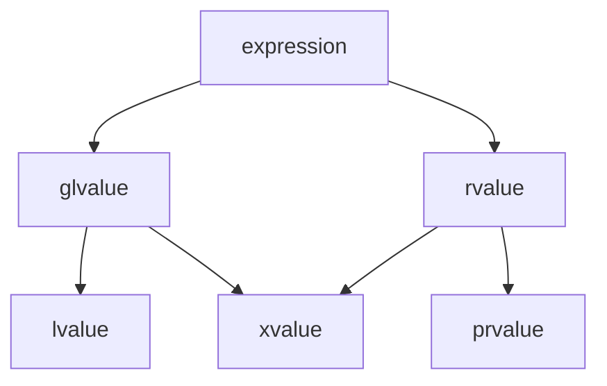
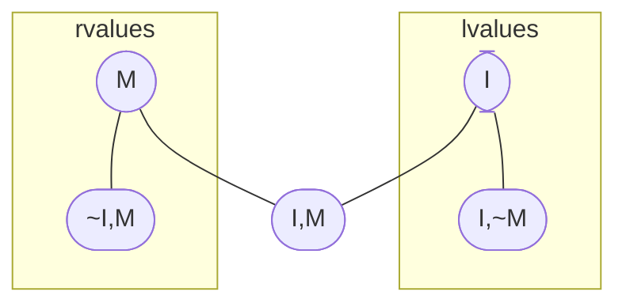

How inference in the `C++` programming language works and how it is related to other semantic processes.

Hot take - type inference in `C++` is shit btw.

## Hindley-Miner style inference
In some programming languages (not `C++`) type inference looks like pure magic:
```haskell
f g [] = []
// function f here takes something called g
// and empty list - [] and returns empty list []

f g (x:xs) = g x : f g xs
// if function f takes something called g
// head of the list is x 
// and rest of the list is xs
// so list if I call it like 
f (*2) [1, 2, 3]
// initially x = 1, xs = [2, 3]

// so f here is a recursive function
// which takes an element and applies
// g to it, and then recursevly calles 
// itself on the rest of the list, so
// after 
x = 1, xs = [2 , 3]
x = 2, xs = [3]
x = 3, xs = []

// so we see the pattern
// second one
f (*2) [1, 2, 3] ->
// second one
[2] : f (*2) [2, 3] ->
// second one
[2, 4] : f(*2) [3] ->
// first one
[2, 4, 6] : f(*2) [] -> [2, 4, 6]

// more often such procedure called map
```
This infers principal type:
```haskell
f :: (A -> B) -> [A] -> [B]
```
How does it work?
## Unification procedure
```haskell
f g [] = []
f g (x:xs) = g x : f g xs
```
First lets assign variables:
```text
typeof(f) = A, typeof(g) = B,
typeof(x) = C, typeof(sx) = D

(lhs :) :: Z -> [Z] -> [Z],
(rhs :) :: Y -> [Y] -> [Y]
```
Now we need to solve the system of equations:
```text
D = [Z], C = Z, B = C -> Y,
A = B -> D -> E, E = [Y]
```
Through a series of substitutions we get the `principle type`:
```text
A = (Z -> Y) -> [Z] -> [Y]
```
## More `C++` style pseudo code
If this were in `C++`, it would look something like this (pseudo code):
```cpp
auto map(auto f, auto ls) {
	if (ls.empty()) {
		return ls;
	}
	
	auto x = head(ls);
	auto xs = tail(ls);
	
	return list{f(x), map(f, xs)};
}
```

From this, we could deduce (pseudo code):
```cpp
template <typename T, typename U, Callable F>
requires requires (F f, T t) { f(t) -> convertible_to<U>; }
list<U> map(F f, list<T> ls);
```
## Discussion
It seems like a dream.
Why not do it this way?
## Transform overload set again
What is principal type here? (mad...):
```cpp
template <class InputIt, class OutputIt, class UnaryOp>
OutputIt transform(InputIt first1, InputIt last1, 
				   OutputIt d_first, UnaryOp unary_op);
				   
template <class ExecutionPolicy,
		  class ForwardIt1,
		  class ForwardIt2,
	      class UnaryOp>
OutputIt transform(
	ExecutionPolicy&& policy,
	ForwardIt1 first1, ForwardIt1 last1, 
	ForwardIt2 d_first, UnaryOp unary_op);
	
template <class InputIt1,
		  class InputIt2,
		  class OutputIt,
		  class BinaryOp>
OutputIt transform(
	InputIt first1, InputIt last1,
	InputIt first2,
	OutputIt d_first, BinaryOp binary_op);

```
## You must choose
A language can have either overloading with a different number of arguments, or Hindley-Milner-style type inference.

This is why Haskell or OCAML do not have function overloading.

Instead, they have pattern matching.
It looks like overloading, but assumes the existence of a principal type:
```haskell
sumFirstN 0 _ = 0
sumFirstN _ [] = 0
sumFirstN 1 (x:_) = x
sumFirstN n (x:xs) = x + sumFirstN (n - 1) xs
```
## One step deduction
Generally, functions and variables in `C++` perform one-step deduction:
```cpp
void foo(std::integral auto x);

foo(5); // -> int

std::integral auto a = 5; // -> int

```
Here, the type is deduced in the immediate context of the call or initialization.
## Ambiguous deduction
Any ambiguity is resolved manually:
```cpp
template <typename T> 
T max(T x, T y) { .... }

auto x = max(1, 2); // -> int
auto x = max(1, 2.0); // -> FAIL

auto x = max<double>(1, 2.0); // -> double

```
In the last case, we essentially perform manual type substitution.

In these lectures, I consider direct substitution as a special case of a very simple deduction.
## Default arguments
Template parameters with default arguments can serve as hints for substitution (function parameters with default arguments are ignored during deduction):
```cpp
template <typename T = double> double foo (T x = 1.5);

auto v0 = foo(2.0); // -> double
auto v0 = foo(1); // -> int 
auto v0 = foo(); // -> double

```

Only the last line will break if the template's default parameter is removed.
## Type deduction after substitution
Type deduction inside a template function creates deduction points where the type can only be resolved after substitutuion:

```cpp
template <typename T>
T max(T x, T y) { .... }

template <typename T>
T min(T x, T y) { .... }

template <typename T>
bool test_minmax(const T& x, const T& y) {
	if (x > y) return test_minmax(y, x);
	return min(x, y) == x && max(x, y) == y;
}

```
Thus, name lookup, deduction, and substitution are engaged alternately.
## Normal process
We already encountered such a case of semantic process:
![[Pasted image 20260804204119.png]]
## Type decaying during deduction
During deduction, references and top-level cv-qualifiers are stripped:
```cpp
const int& a = 1; int b = 2; const int c = 1; int& d = b;

auto x = max(a, b); // -> int
auto y = max(c, d); // -> int

std::intergral auto z = a; // -> int
std::intergral auto w = d; // -> int
```
This is done to avoid generation functionally identical specializations.
## Deduction of elaborated types
if the template type is elaborated, the argument will be elaborated accordingly:
```cpp
template<typename T> T max(const T& x, const T& y);
auto a = max(1, 3); 
// -> int max<int>(const int&, const int&);

```
Elaborated deduction works differently with types - it preserves cv-qualifiers:
```cpp
template<typename T> void foo(T& x);

const int &a = 3;
foo(a); // -> void foo<const int>(const int& x);

const int c = 1;
auto& z = c; // -> const int& !!!

```
## Strange aspects of recursive deduction
This code works fine:
```cpp
auto sum(int i){
	 if (i == 1){
		 return i;
	 } else {
		 return sum(i - 1) + 1;
	 }
}

```
But this one is compilation error:
```cpp
auto sum(int i){
	if (i == 1){
		 return sum(i - 1) + i;
	} else {
		 return i;
	}
}

```
And this one also fails:
```cpp
auto sum(int i){
	return (i == 1) ? i : sum(i - 1) + 1;
}

```

The reason for such behavior explained in a standard: 
Once a non-discarded return statement **has been seen** in a function, however, the return type deduced from that statement **can be used** in the rest of the function, including in other return statements `[dcl.spec.auto.general]`

## Do compilers have eyes?
in the `C++23` standard, the expression "has been seen" appears only three times:
![[Pasted image 20260804210839.png]]

It's meaning is vague in all these cases.

But seems like it's just about real physical presence in the code, linewise.

## Some complexities of initialization
```cpp
auto x1 = {1, 2};    // std::initializer_list<int>
auto x2 = {1, 2.0};  // Compile-time error: int and double deduce different types
auto x3{1, 2};       // Compile-time error: direct-list initialization requires one element
auto x4 = {3};       // std::initializer_list<int> containing 3
auto x5{3};          // int with value 3
```
# Discussion
An interesting question is what will auto deduce for an rvalue reference?
```cpp
auto&& v = x; // -> ???
```

Or, what is the same, what will the template deduce under the same circumstances?
```cpp
template <typename T> foo(T&& v); foo(x); // -> ???
```

## Expressions
An `expression` is a sequence of operators and operands that specifies a computation.
```cpp
int a = 5, b;
b = a + 2; // a + 2 is a prvalue expression
```
A `glvalue` is an expression that identifies an (expiring, but) persistent object.
A `prvalue` is a recipe for creating an object.
Whenever a `glvalue` appears as an operand of an operator that expects a `prvalue` for that operand, [...] standard conversions are applied to convert the expression to a `prvalue` [`[basic.lval]`](https://eel.is/c++draft/basic.lval).


## Recall Lvalues and Rvalues
I - identity
M - moveability

This taxonomy is provided to better describe state of object valueness:

| IM-code | term      |
| ------- | --------- |
| `I`     | `glvalue` |
| `M`     | `rvalue`  |
| `I, ~M` | `lvalue`  |
| `I, M`  | `xvalue`  |
| `M, ~I` | `prvalue` |



## Reference Collapsing Rules
In the context of type deduction, when reference collapsing is necessary, an `lvalue` reference prevails if present.
```cpp
int x;
int &y = x;
auto &&c = y; // -> int &
auto &&d = std::move(y); // -> int &&
```
It turns out that `auto&&` is either an `lvalue` reference or an `rvalue` reference (depending on the context).
```cpp
auto &&y = x; // x is some& -> y is some&
template <typename T> void foo(T&& t); foo(x); // the same
```

## Universal References
```cpp
auto &&y = x; // x is some& -> y is some&
template <typename T> void foo(T&& t); foo(x); // the same
```
Such references are called `forwarding references`. Meyers suggested calling them `universal references`.

But remember - context for reference collapsing could be eliminated! 
We need `type deduction` to be triggered, not just `type substitution`

Some examples of making from deduction actually substitution context:

The context for collapsing will not be created if the type is more elaborated than `&&`.
```cpp
template <typename T> void buz(const T&& param);
```
This also holds true for `auto`.
```cpp
const auto &&x = y; // no collapsing here
```

## Non-Universal References
The collapsing context requires `type deduction`, not `type substitution`.
```cpp
template <typename T> struct Buffer {
  void emplace(T&& param); // substitute T
  // class is templated and deduce context will
  // be preserved for it only in constructor (but its a secret)
  // but function only gets substituted type here!
```
```cpp
template <typename T> struct Buffer {
  template <typename U> void emplace(U&& param); // deduce U
```
The collapsing context breaks if something other than an `rvalue reference` is elaborated.
For the second example, what is `U` formally deduced to?
## The Main Hack in Type Deduction
When collapsing types with templates, we must also deduce the template parameter type.
```cpp
template <typename T> int foo(T&&);

int x;
int& y = x;

foo(x); // → int foo<int&>(int&)
foo(y); // → int foo<int&>(int&)
foo(5); // → int foo<int>(int&&)
```
For consistency, it is deduced as a reference for `lvalues` but not for `rvalues`!

## This is Exactly How `std::move` Works
Pseudocode for `std::move` (we will improve it).
```cpp
template <typename T,
          typename R = std::remove_reference_t<T>&&>
R almost_move(T&& a) {
  return static_cast<R>(a);
}
```
This wouldn't work if the deduction of `T` didn't depend on the `value category` of the expression we are moving.
```cpp
int x; auto y = almost_move(x); // T = int&, R = int&&
```

## Motivation for `decltype`
The `auto` keyword either strips types or adds qualifiers.
Furthermore, it uses the right-hand side for both deduction and assignment.
```cpp
const int x = 5;

auto y = x; // y -> int
auto &z = x; // z -> const int&
```
To deduce the exact type, we have `decltype`.
```cpp
decltype(x) t = 6; // t -> const int
```
But this raises one question....

## Decltype: What is the Exact Type?
The priority for `decltype` is the exact type of the parameter.
```cpp
const int &x = 42;
decltype(x) y = 42; // -> const int &y = 42;
```
This is fine. But there is a problem:
```cpp
struct Point { int x, y; };

Point porig {1, 2};
const Point &p = porig;

decltype(p.x) x = 0; // int x or const int &x?
```

## Decltype: name and expression
```cpp
struct Point { int x, y; };

Point porig {1, 2};
const Point &p = porig;
```
Case `decltype(id-expr)`
```cpp
decltype(p.x) x = 0; // → int x = 0;
```
Case `decltype(expr)`
```cpp
decltype((p.x)) x = 0; // → const int &x = 0;
```
The exact type is `decltype(name)`, whereas `decltype(expr)` works based on `value category`.

## Rules for `decltype(id-expr)`
```cpp
int x; decltype(x) t1 = y; // name → int
```
`decltype(id-expr)` distinguishes value categories.
For `lvalues`, it adds an `lvalue reference`.
```cpp
decltype((x)) t2 = y; // lvalue expr → int&
```
For `xvalues`, it adds an `rvalue reference`.
```cpp
decltype(std::move(x)) t3 = 1; // xvalue expr → int&&
```
For `prvalues`, it adds nothing.
```cpp
decltype(x + 0) t4; // prvalue expr → int
```

## Value Abstraction
In some cases (for example, for use inside `decltype`), we want to obtain a value of some type.
Often, the `default constructor` is used for this.
```cpp
template <typename T> struct Tricky {
  Tricky() = delete;
  const volatile T foo();
};

decltype(Tricky<int>().foo()) t; // error
```
But what if it doesn't exist? What is a "value in general" for such a type?

## Value Abstraction: memory chunk
A person well-versed in C might say that a value as such is the result of interpreting raw memory.
```cpp
template <typename T> struct Tricky {
  Tricky() = delete;
  const volatile T foo();
};

decltype(((Tricky<int>*)0)->foo()) t; // works, but this is UB
```
At compile-time, any `reinterpret_cast` is forbidden by the standard.

## Value Abstraction: `declval`
An interesting way to solve these problems is to introduce a `function template` (which deduces types) without a body (so it cannot be accidentally called).
```cpp
template <typename T>
std::add_rvalue_reference_t<T> declval(); // нет тела
```
Now it's simple.
```cpp
template <typename T> struct Tricky {
  Tricky() = delete;
  const volatile T foo ();
};

decltype(declval<Tricky<int>>().foo()) t = 0; // ok, cv-int
```